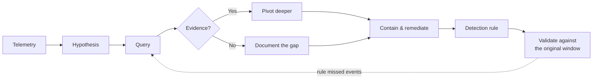

B.S. Computer Science, CySA+, ITIL.

Former Cybersecurity Engineer intern at LOG(N) Pacific.

Open to technical support and IT roles (remote Americas, Rio de Janeiro).

[LinkedIn](https://www.linkedin.com/in/joaomarcelo-miranda/) · [TryHackMe](https://tryhackme.com/p/jo.marcelo) · [YouTube](https://www.youtube.com/@J-MarceloMiranda)

---

## Featured: [IT Help Desk Lab](https://github.com/jo-marcelo/it-help-desk-lab)

A Tier 1 help desk built end to end in three parts: the admin work, the ticketing, and the phone call.

**Microsoft Entra ID.** A tenant on my own domain, worked through the tickets a help desk handles every week.
- Admin password resets with a forced change at first sign-in, and self-service password reset
- MFA enrollment under security defaults, and recovery for a user who lost their phone
- The Helpdesk Administrator role tested from both sides. It reset a standard user's password and was blocked on a Global Administrator's
- Licensing limits on Entra ID Free written down instead of assumed

**GLPI ticketing.** GLPI 11 in Docker with ITIL categories, three support groups, and P1 to P4 SLAs applied by business rules. Eight tickets worked end to end, including escalations to Security and Network.

**AI help desk simulator.** Claude plays the caller, I work the ticket, and a second model grades the call against a fixed rubric, quoting the transcript line behind every deduction. Eight scenarios, from a forgotten password to a Sales Director demanding a reset 20 minutes before a board call, calling from an unknown number. That one tests whether identity verification holds under pressure.

---

## Security case study: [Hidden Directive](https://github.com/jo-marcelo/sentinel-mde-dfir-domain-compromise)

Full incident response investigation of a simulated Azure control-plane compromise, reconstructed from Microsoft Sentinel and Defender XDR telemetry.

An attacker used Azure Run Command to reset a local admin password as SYSTEM, then moved to the domain controller over six hours and planted an **AdminSDHolder ACL backdoor**. Active Directory re-applies that permission every hour, so it survives password resets and host rebuilds.

- 28 documented KQL queries across a 17-hour window and three hosts
- Static analysis of five recovered artefacts, with named-pipe strings matched against live Sysmon telemetry
- Two validated detection rules for techniques that generated no alert during the incident
- Four evidence gaps documented as gaps, with what would resolve each

**[Read the full report (PDF, 20 pages)](https://github.com/jo-marcelo/sentinel-mde-dfir-domain-compromise/blob/main/report/GF-INC-2026-0704-Incident-Report.pdf)**

---

## Other projects

| Project | What it demonstrates | Stack |
|---|---|---|
| **[azure-threat-hunting-kql](https://github.com/jo-marcelo/azure-threat-hunting-kql)** | Hunting internet-facing brute force against an exposed Azure VM, then proving *no* compromise through two independent correlation methods | MDE, KQL, Azure |
| **[mde-threat-hunting-network-slowdown](https://github.com/jo-marcelo/mde-threat-hunting-network-slowdown)** | Tracing a reported network slowdown to an unauthorized Living-off-the-Land PowerShell port scan, from detection through containment | MDE, KQL, PowerShell |
| **[stig-hardening-monorepo](https://github.com/jo-marcelo/stig-hardening-monorepo)** | Automated remediation and rollback for 10 DISA STIG controls on Windows 11, built around a scan-verify loop | PowerShell, Local GPO, Registry |
| **[tenable-vulnerability-management-lab](https://github.com/jo-marcelo/tenable-vulnerability-management-lab)** | Running a vulnerability management lifecycle end to end across six remediation cycles, each verified by its own delta scan. Findings went from 24 to 4, and one end-of-life package accounted for 17 of them | Tenable Nessus, Azure, PowerShell |

---

## How I work

The dashed line is the part that matters. On the DFIR case, I validated a finished rule against the incident it was written from. KQL's `has_any` matches whole tokens, and RemCom appends a random suffix to three of its named pipes, so the rule caught 1 of 7 events. Rewriting it with `contains` caught all seven and surfaced a second attacker session the original write-up had missed.

The same habit applies on the help desk side. A fix isn't done when the setting changes. It's done when I've confirmed the user can actually sign in.
